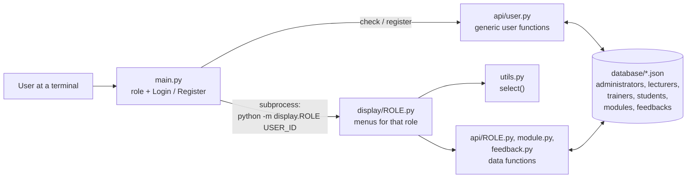
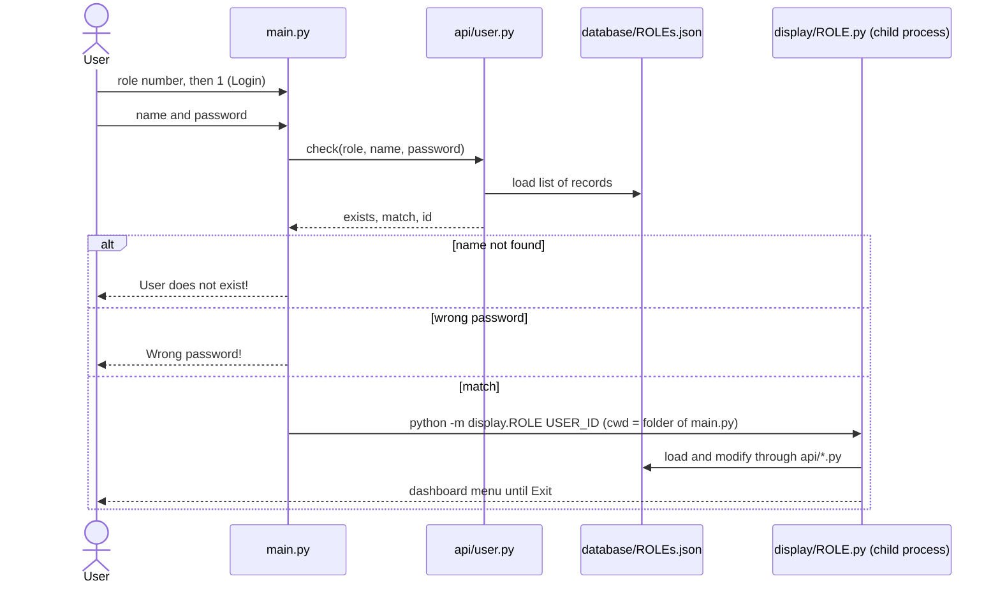
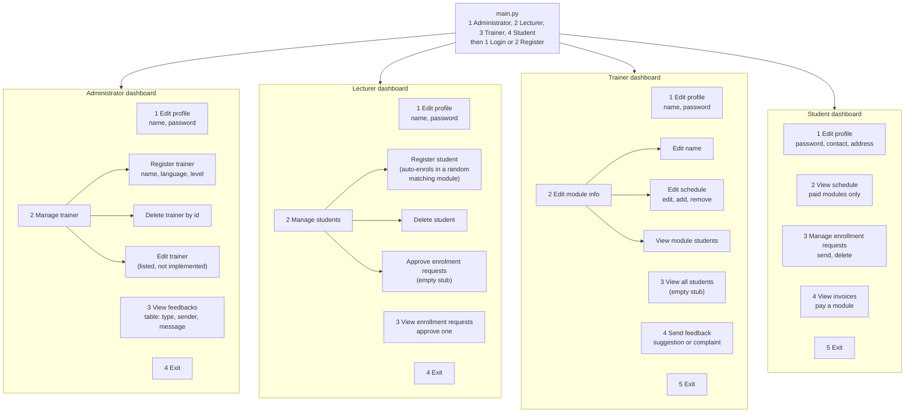
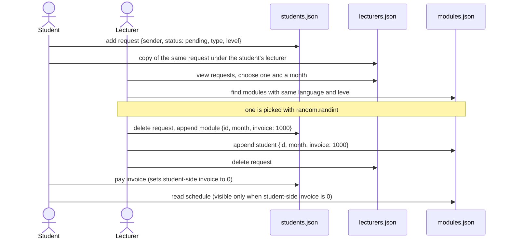
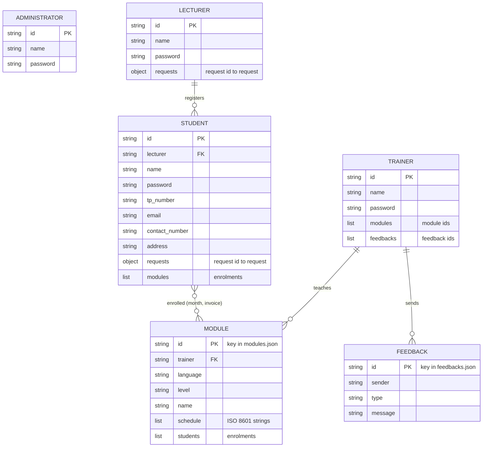

# APU Programming Cafe Management System

A console application for running a small **programming-course "cafe"**: students ask to join Python, Java or C courses, lecturers register students and approve those requests, trainers manage the modules they teach and send feedback, and administrators manage trainers and read that feedback. It was written as a group assignment for a Python Programming module at Asia Pacific University (the accompanying report is dated February 2024).

It is plain Python with **no third-party packages**. Every user type logs in through one menu in `main.py`, then lands in a role-specific dashboard that runs as a separate Python process. All data lives in six hand-readable **JSON files** in `database/`.

> **Current status:** the damaged Python source has been repaired. All four roles can log in, open their dashboard and exit in the regression checks. This remains a coursework application with incomplete features and data-consistency problems; see [Verification](#current-status-of-this-snapshot) and [Issues](#issues-found).

---

## Table of contents

1. [What it does](#what-it-does)
2. [Current status of this snapshot](#current-status-of-this-snapshot)
3. [Architecture](#architecture)
4. [How login and launch work](#how-login-and-launch-work)
5. [Roles and menus](#roles-and-menus)
6. [The enrolment workflow](#the-enrolment-workflow)
7. [Data model](#data-model)
8. [Project structure](#project-structure)
9. [Setup and run](#setup-and-run)
10. [Code walkthrough](#code-walkthrough)
11. [Example session](#example-session)
12. [Troubleshooting](#troubleshooting)
13. [Issues found](#issues-found)
14. [Security and privacy notes](#security-and-privacy-notes)
15. [The documentation PDF versus the code](#the-documentation-pdf-versus-the-code)
16. [Next steps](#next-steps)

---

## What it does

- One entry point (`main.py`) asks for a **role** (Administrator, Lecturer, Trainer, Student) and an **action** (Login or Register).
- Login compares the name and password against `database/<role>s.json`; on success it starts the matching dashboard in a child process and passes the user's UUID on the command line.
- **Administrator**: edit own profile, register a trainer (with a first module) or delete a trainer, read all trainer feedback.
- **Lecturer**: edit own profile, register or delete students, and turn a student's enrolment request into an enrolment.
- **Trainer**: edit own profile, rename a module and edit its schedule, send a suggestion or complaint to the administrators.
- **Student**: edit own profile (password, contact number, address), request a module (language and level), view schedules, and pay invoices. The schedule of an unpaid module is hidden.

| Technology | Role |
|---|---|
| Python 3.10 or newer | Language. `match` / `case` statements are used throughout, so 3.10 is the minimum |
| Standard library only | `json`, `uuid`, `os`, `sys`, `subprocess`, `datetime`, `random`, `typing` |
| JSON files in `database/` | The whole "database", rewritten in full on every change |
| Text menus (`input()` / `print()`) | The user interface |

---

## Current status of this snapshot

The original upload had truncated file-writing statements, misplaced indentation, missing closing delimiters and a missing function header in `api/module.py`, `api/trainer.py` and the legacy root `student.py`. Those damaged statements have been restored. The legacy request-status f-string is also compatible with Python 3.10 again.

Verification performed with Python **3.10.9**:

- All 15 application Python files pass the Python 3.10 syntax check.
- Administrator, Lecturer, Trainer and Student can each log in through `main.py`, reach the correct dashboard and exit.
- Six regression tests check syntax, the four login/dashboard paths, persisted module creation and deletion, schedule edits, enrollment and invoice updates, trainer profile/module/feedback updates, trainer deletion, and the legacy request display/delete path.
- Tests use disposable app copies with fictional JSON fixtures. They do not change the six supplied database files.
- The same tests fail against the original upload, reproducing its syntax damage.

Run the checks from the repository root:

```bash
python -B -m unittest discover -s tests -v
```

Passing these checks establishes startup and the repaired operations; it does not establish that every menu option works. The remaining problems below were found by reading the code and are not all reproduced by the tests.

---

## Architecture



Three layers:

| Layer | Folder | Job |
|---|---|---|
| Entry | `main.py` | Pick role, log in or register, start a dashboard |
| Display | `display/` | Print menus, read input, call API functions. Each file is a script that reads the user id from `sys.argv[1]` and starts its dashboard at import time |
| API | `api/` | Load a JSON file into memory when the module is imported, change it, write the whole file back |

---

## How login and launch work

There is no session object, token, or logout. The "session" is simply the child process that runs the dashboard; choosing *Exit* ends it.



Registration (`2. Register`) calls `user.check` first and prints `User already exists!` if the **name** is already taken for that role. Otherwise `user.register` appends `{id, name, password}` to the file. It does not log the new user in and prints nothing on success.

Passwords are stored and compared as plain text (`==`).

---

## Roles and menus



### Menu details (as written in the code)

**Administrator** (`display/administrator.py`)

| Menu | Behaviour |
|---|---|
| Edit profile | Change name or password. No length check, no confirmation |
| Manage trainer, Register | Asks for a trainer name, a language (`python`, `java`, `c`) and a level (`beginner`, `intermediate`, `advanced`). Creates a trainer with the default password `123` and one module named `"<language> <level>"`, then prints the trainer's UUID |
| Manage trainer, Delete | Asks for the trainer's UUID. Deletes the trainer and all modules listed on the trainer. Prints whether the id existed |
| Manage trainer, Edit | Printed in the menu but there is no `case 3`, so the program ends silently |
| View feedbacks | Prints a padded table of Type, Sender, Message for all feedback, then waits for Enter |

**Lecturer** (`display/lecturer.py`)

| Menu | Behaviour |
|---|---|
| Edit profile | Change name or password |
| Manage students, Register | Asks for name, TP number, contact number, address, module type, module level, enrolment month. Creates the student (password `123`, email `<tp number lower-cased>@mail.apu.edu.my`, `lecturer` set to the registering lecturer), then enrols them in a **randomly chosen** module that matches the language and level |
| Manage students, Delete | Lists students as `name tp_number`, deletes the chosen one and removes them from module enrolment lists |
| Manage students, Approve | Empty (`pass`); the program ends. Use main menu option 3 instead |
| View enrollment requests | Lists `sender-uuid language level`, lets the lecturer pick one and an enrolment month, enrols the student in a random matching module. There is no reject option |

**Trainer** (`display/trainer.py`)

| Menu | Behaviour |
|---|---|
| Edit profile | Change name or password |
| Edit module info | Pick one of the trainer's modules, then: rename it, edit the schedule (edit / add / remove / view students), or view its students |
| View all students | Empty (`pass`); the program ends |
| Send feedback | Choose `suggestion` or `complaint`, type a message; stored in `feedbacks.json` and the feedback id is appended to the trainer's `feedbacks` list |

Schedule entries are typed as `MM/DD/YYYY` and 24-hour `HH:MM`, and stored as ISO 8601 strings (for example `2025-12-25T12:00:00`). The list is re-sorted after every add or edit.

**Student** (`display/student.py`)

| Menu | Behaviour |
|---|---|
| Edit profile | Change password, contact number or address, then return to the same menu |
| View schedule | For each enrolled module: if the invoice is not 0, prints "Unpaid" and hides the schedule; otherwise prints dates like `Monday, Dec 25 2023 - 12:00 PM`, or "No schedule for this module" |
| Manage enrollment requests | Send a request (language and level) or delete one. A sent request is stored on both the student and their lecturer |
| View invoices | Lists unpaid modules with the amount (`1000`). Choosing one sets its invoice to `0`. There is no amount entry or payment check. Prints `All modules paid!` when nothing is owed |

---

## The enrolment workflow



Two things to know:

- The invoice amount is a hard-coded `1000` per enrolment, in two places (`api/student.py` `add_module` and `api/module.py` `add_student`).
- The invoice is stored twice (on the student and on the module's student list), but paying only changes the student's copy. The restored `module.pay_student_invoice` function updates the module's copy, but the student payment menu does not call it.

---

## Data model

All records are keyed by UUID strings (`uuid.uuid4()`). Foreign keys are plain id strings; nothing enforces them.



### File formats

`administrators.json`, `lecturers.json`, `students.json` and `trainers.json` are **JSON arrays** of records. `modules.json` and `feedbacks.json` are **JSON objects keyed by id**.

| File | Top level | Fields per record |
|---|---|---|
| `administrators.json` | array | `id`, `name`, `password` |
| `lecturers.json` | array | `id`, `name`, `password`, `requests` (object) |
| `students.json` | array | `id`, `lecturer`, `name`, `password`, `tp_number`, `email`, `contact_number`, `address`, `requests` (object), `modules` (array) |
| `trainers.json` | array | `id`, `name`, `password`, `modules` (array of module ids), `feedbacks` (array of feedback ids) |
| `modules.json` | object | `trainer`, `language`, `level`, `name`, `schedule` (array), `students` (array) |
| `feedbacks.json` | object | `sender`, `type`, `message` |

Shapes of the nested pieces (all values are placeholders):

```jsonc
// request  (inside lecturers[].requests and students[].requests, keyed by request id)
{ "sender": "<student-id>", "status": "pending",
  "module_request_type": "java", "module_request_level": "advanced" }

// enrolment  (inside students[].modules and modules[id].students)
{ "id": "<module-id or student-id>", "enrolment_month": "december", "invoice": 1000 }

// module
{ "trainer": "<trainer-id>", "language": "python", "level": "advanced",
  "name": "Advanced Python",
  "schedule": ["2025-12-25T12:00:00"],
  "students": [ { "id": "<student-id>", "enrolment_month": "december", "invoice": 0 } ] }

// feedback
{ "sender": "<trainer-id>", "type": "suggestion", "message": "text" }
```

Allowed values used by the menus: `language` is `python`, `java` or `c`; `level` is `beginner`, `intermediate` or `advanced`; `type` is `suggestion` or `complaint`; `enrolment_month` is a lower-case month name; request `status` is only ever `pending` (an approved request is deleted, never marked).

What the shipped sample data contains: 3 administrator rows, 1 lecturer, 1 student, 3 trainers, 2 modules and 4 feedback entries. They are test values (single-word names, `123` for TP number, phone and address). See [Security and privacy notes](#security-and-privacy-notes).

---

## Project structure

```
APU-Programming-Cafe-Management-System/
├── main.py                  # Entry point: role + login/register, starts dashboards
├── utils.py                 # select(message, items): validated numbered menu
├── student.py               # LEGACY student-only prototype; not used by main.py
├── student display.py       # LEGACY prototype menu (space in file name), unused
├── api/
│   ├── user.py              # Generic check / register / get / set for any role
│   ├── administrator.py     # check, register (not used by the menus)
│   ├── lecturer.py          # Lecturer records and requests
│   ├── student.py           # Student records, modules, invoices, requests
│   ├── trainer.py           # Trainer records, modules and feedback references
│   ├── module.py            # Module records, schedules and enrolments
│   └── feedback.py          # Feedback create / get / get_all
├── display/
│   ├── administrator.py     # Administrator dashboard
│   ├── lecturer.py          # Lecturer dashboard
│   ├── trainer.py           # Trainer dashboard
│   └── student.py           # Student dashboard
├── database/                # JSON "database" (six files, see Data model)
├── tests/
│   └── test_repaired_workflows.py  # Isolated regression checks
├── .gitignore               # Local PDF, bytecode, OS metadata and local configuration
└── README.md                # This guide
```

There are no `__init__.py` files in `api` or `display`; they work as namespace packages. The original documentation PDF remains in the local workspace but is ignored and no longer tracked in the current branch. Generated caches and OS metadata are also ignored.

---

## Setup and run

### 1. Prerequisites

- Python **3.10 or newer** (`match` statements). Nothing to `pip install`.
- A terminal where the command `python` starts that same interpreter (see [Troubleshooting](#troubleshooting)).

### 2. Run

Always start from the repository root, because several API files open `database/...` relative to the current directory:

```bash
cd APU-Programming-Cafe-Management-System
python main.py
```

Use the bundled sample accounts for a local demonstration, or register an administrator and create trainers and students through their role-specific menus. Login-menu registration for the other roles creates incomplete records; see [Issues](#issues-found). Keep a backup of `database/` before trying changes because the app writes to those files directly.

### 3. Starting a dashboard directly

A dashboard can also be started without the login menu if you know a user's UUID from the matching JSON file:

```bash
python -m display.student <student-uuid>
```

Replace `student` with `administrator`, `lecturer` or `trainer`. The id is read from `sys.argv[1]`; there is no authentication at this level.

---

## Code walkthrough

### `main.py`

Runs at import time (no `if __name__ == "__main__"` guard).

1. Prints the four roles and reads a number with `int(input(...))`.
2. Prints `1. Login` / `2. Register` and reads another number.
3. `match choices[1]` calls `handle_login()` or `handle_register()`; any other number ends the program silently.

`handle_login()` calls `user.check`, prints one of the two error messages, or launches `subprocess.run(["python", "-m", "display.<role>", user_id], cwd=<folder of main.py>)`. `handle_register()` refuses an existing name, otherwise calls `user.register`.

### `utils.py`

One function, `select(message, items)`: prints a numbered list and loops until the user enters a valid number, then returns the chosen item. It is the only input helper that validates anything; every other menu uses a bare `int(input())`.

### `api/user.py`

Role-generic helpers. `load_data(type)` reads `database/<type>s.json` (so `administrator` becomes `administrators.json`).

| Function | What it does |
|---|---|
| `check(type, name, password)` | Scans for the **first** record with that name. Returns `{exists, match, id}` (`id` is `False` unless the password matches) |
| `register(type, name, password)` | Appends `{id, name, password}` with a new UUID and rewrites the file. Adds **no** role-specific fields (see Issues) |
| `get(type, id)` | Returns one record or `None` |
| `set(type, id, key, value)` | Sets one field and rewrites the file. Used by the administrator dashboard |

### `api/` role modules

Each file below loads its JSON into a module-level variable at import time, edits that in-memory copy, and rewrites the entire file.

| Module | Functions | Parses |
|---|---|---|
| `administrator.py` | `check`, `register` | yes (unused by the dashboards, which go through `user.py`) |
| `lecturer.py` | `get`, `check`, `register`, `change_name`, `change_password`, `add_request`, `remove_request`, `delete_request` | yes |
| `student.py` | `get`, `get_all`, `register` (password `123`, derived email), `delete`, `change_password`, `change_contact`, `change_address`, `add_module` (invoice 1000), `pay_invoice`, `add_request` (returns id and data), `delete_request` | yes |
| `feedback.py` | `create(sender, type, message)`, `get(id)`, `get_all()` | yes |
| `module.py` | `set`, `add_schedule`, `remove_schedule`, `edit_schedule`, `create`, `add_student`, `pay_student_invoice`, `remove_student`, `get_filtered_modules(language, level)`, `get`, `delete` | yes; damaged bodies and file writes restored |
| `trainer.py` | `delete` (also deletes assigned modules), `register` (default password `123`), `get`, `add_module`, `add_feedback`, `change_password`, `change_name` | yes; assignments and file writes restored |

### `display/` dashboards

Each file reads `sys.argv[1]`, loads the user, and calls `display_dashboard()` on the last line. Menus call each other recursively instead of looping, so a long session grows the call stack. After any handler that has no matching `case` (for example an out-of-range number) the script simply ends.

### Legacy files in the repository root

`student.py` and `student display.py` are an earlier student-only prototype (the display filename contains a space). The prototype requires a 6-character minimum for new passwords and prints colored messages, but it is not reachable from `main.py`. Its syntax is repaired; the prototype still has unfinished functions, a different request schema and an undefined `pending` variable in its menu, so use `display/student.py` for the actual application.

---

## Example session

A transcript derived from the code (a fresh administrator, with placeholder values):

```
$ python main.py
Enter as:
1. Administrator
2. Lecturer
3. Trainer
4. Student

Enter choice: 1

Action:
1. Login
2. Register

Enter choice: 2
=== Register as administrator ===
Name: demo_admin
Password: <your-password>          # echoed on screen; input() is used
$                                  # program ends, nothing is printed
```

Run `python main.py` again, choose `1`, then `1` (Login), and enter the same name and password:

```
Logging in as Administrator...
Name: demo_admin
Password: <your-password>
```

The administrator dashboard appears:

```
Administrator Dashboard
1. Edit profile
2. Manage trainer
3. View feedbacks
4. Exit

Enter choice:
```

Wrong inputs seen at the first prompt: a wrong password prints `Wrong password!`; an unknown name prints `User does not exist!`; a letter instead of a number raises an unhandled `ValueError`.

---

## Troubleshooting

| Problem | What to check |
|---|---|
| `IndentationError` / `SyntaxError` right after logging in | Use the repaired source from the current branch and Python 3.10+. Run the regression checks to verify your checkout |
| `FileNotFoundError: 'python'` after logging in | `main.py` launches `"python"`, not the running interpreter. Ensure a `python` executable or shim is on `PATH`, or change the subprocess command to use `sys.executable`. Shell aliases are not used by this subprocess call |
| `SyntaxError` on a `match` line | Python is older than 3.10 |
| `FileNotFoundError: database/...json` | Start from the repository root; `api/student.py` and parts of `api/lecturer.py` open relative paths |
| `KeyError: 'lecturer'` / `'modules'` / `'requests'` for a user created from the login menu | Menu registration creates only `{id, name, password}`. Create students through a lecturer and trainers through an administrator instead |
| A second user with the same name cannot log in | Login uses the first record with that name; the sample administrators file contains two `john` rows and only the first can ever log in |
| Changes seem to vanish | Each running dashboard keeps its own in-memory copy and rewrites the whole file; the last process to save wins. Run one session at a time |

---

## Issues found

The startup-blocking syntax damage is fixed and covered by the regression checks. The following issues remain; most are code-review findings rather than exhaustive runtime reproductions. File and function names identify the relevant paths.

**Interpreter and functional issues**

1. `main.py` launches `"python"` rather than `sys.executable`; that command must resolve to the intended interpreter.

**Functional bugs**

2. **Login-menu registration builds incomplete records** (`api/user.py` lines 34-41). A new lecturer has no `requests`, a student has no `lecturer`, `modules` or `requests`, and a trainer has no `modules` or `feedbacks`, so role-specific dashboard actions can raise `KeyError` when they need those missing fields. `api/lecturer.register` also creates `"requests": []` (a list) while all other code treats it as a dictionary.
3. **Feedback sender mismatch.** `display/trainer.py` line 17 stores the trainer's **name** as `sender`, but `display/administrator.py` line 83 looks the sender up **by id** with `trainer.get(...)["name"]`, so any newly sent feedback makes the admin view fail with a `TypeError`. The sample `feedbacks.json` stores ids, so the sample data hides the bug.
4. `display/administrator.py` lines 70-73: `max()` over an empty list raises `ValueError` when there is no feedback.
5. `display/trainer.py` line 97 calls `view_students()`, which is defined inside a different function (line 118), so choosing "View students" in the schedule menu raises `NameError`. Line 120 also passes a dictionary (`{"id": ...}`) to `student.get`, which expects an id string, so even the working copy would raise `TypeError`.
6. "Edit trainer" (administrator), "Approve enrolment requests" in the lecturer's student menu, and trainer "View all students" are unimplemented and end the program.
7. `register_student()` in `display/lecturer.py` calls `randint(0, len(...) - 1)` without checking for an empty list of matching modules. This raises `ValueError` **after** the student has already been saved, leaving a student with no modules. The separate request-approval path checks for no matches before choosing a module.
8. Deleting a trainer deletes their modules but not the students' enrolments in those modules (`display/student.py` would then fail with `KeyError` in the schedule view). Deleting a student does not remove their pending request from the lecturer's list (the sample `lecturers.json` has a request from a sender that does not exist in `students.json`).
9. Invoice state is duplicated and inconsistent; the sample data already shows it (a module with student invoice `0` in `students.json` but `1000` in `modules.json`). `trainers.json` also lists a module id that is not in `modules.json`.
10. Unvalidated input: most menus use bare `int(input())` calls that crash on a letter or empty line, and `strptime` crashes on a bad date. Entering `0` at the role prompt selects "student" because `roles[-1]` is used (`main.py` line 23).
11. User names are not unique when users are created by administrators or lecturers, and `check` stops at the first match.
12. No login attempt limit, no password rules (except the unreachable legacy file), no way to reset a password.
13. Some functions open `"database/....json"` relative to the current directory (`api/student.py` throughout, `api/lecturer.py` line 68), while others use paths relative to the file. Several handles are never closed (`api/user.py` line 8).
14. `display/trainer.py` line 1 contains a TODO comment with profanity.

**Repository hygiene**

15. `.DS_Store` and cached Python bytecode were tracked in the original upload. They are now untracked and covered by `.gitignore`; historical commits still contain them.
16. Runtime data (`database/*.json`) is committed and will be overwritten by normal use.

---

## Security and privacy notes

- **Plain-text passwords everywhere.** Passwords are saved unhashed in all four user files and compared with `==`. The default password for trainers and students created by an administrator or lecturer is the literal `123` (`api/trainer.py` line 33, `api/student.py` line 111).
- **Sample accounts with trivial passwords are public.** `database/administrators.json` lines 2-4 hold three administrators (two with the same name), and the other user files hold accounts whose passwords are `123`. These are test accounts, but anyone can read them; do not reuse these values and remove or regenerate them before deploying anything.
- **No real personal data was found in `database/`.** Names are single words, the TP number, contact number and address of the sample student are all `123`, and the email is derived from the TP number. The feedback entries contain jokes and one profane message (`database/feedbacks.json` lines 10 and 20); consider rewriting them.
- **The documentation PDF contains personal details and signatures.** It is kept locally, listed in `.gitignore`, and removed from the current tracked files. It remains downloadable from older commits because repository history has not been rewritten for this file.
- **No authorisation checks inside dashboards.** The user id is a command-line argument; anyone who can run `python -m display.administrator <any-id>` gets that dashboard, and the id is never verified (expected).
- **No concurrency protection.** Whole-file rewrites from multiple processes can lose data.
- `.DS_Store`, `__pycache__/`, bytecode and the local documentation PDF are now ignored. The six bundled JSON files remain tracked to preserve the runnable coursework example; do not replace them with real personal records in a public repository.

---

## The documentation PDF versus the code

The local-only `APU Programming Cafe Management System Documentation.pdf` is a roughly 121-page assignment report: assumptions, pseudocode and code listings per team member, explanation of programming concepts, additional features, sample input/output screenshots for every menu, a conclusion and a work-breakdown table. I read the cover, table of contents, introduction and assumptions, the first code pages, the additional-features and sample-output start (pages 73-77) and the conclusion. The report describes a more complete program than this repository contains:

| The report says | The code in this repository |
|---|---|
| The external library `tabulate` must be installed (`python -m pip install tabulate`) | No file imports `tabulate`; everything uses `print` |
| Wrong passwords give a limited number of attempts (4 chances) | One attempt, then the program ends |
| `utils.py` has `red`, `green`, `bold` and `input_number` helpers | `utils.py` only has `select`, and it has its own validation loop. Colors are defined only in the legacy `student display.py` |
| Registering as administrator gives the password `123`; registration continues to the dashboard | The password typed by the user is saved and nothing else happens |
| Trainer salary is computed as 1000 / 1500 / 2000 per enrolled student for beginner / intermediate / advanced | No salary code; `display/trainer.py` has a TODO about "charges" |
| Administrators can filter feedback by type (`display/administrator.py` lines 283-338) | The file has 113 lines and no filter |
| `api/student.py` wraps file loading in a `FileNotFoundError` handler | No error handling |
| Students must change the default password `123` on first login | Matches: default is `123`, but nothing forces a change |
| Unpaid modules hide the schedule | Matches (`display/student.py`) |

So the report is useful for the intended design and screenshots, but it is not an accurate description of this code.

---

## Next steps

The syntax repair, local-PDF ignore rule, cache cleanup and regression tests are included in this revision. Further improvements would be:

1. Replace `"python"` with `sys.executable` in `main.py`, add a main guard, and use loops for menus.
2. Hash passwords, limit login attempts, and require a change of default passwords.
3. Build complete role-specific registration records and enforce unique names per role.
4. Fix feedback sender IDs, student-list handlers and empty-data cases.
5. Keep invoice state in one place and clean up relationships when deleting trainers or students.
6. Implement unfinished menu choices and validate numeric and date inputs.
7. Separate sample data from runtime storage and replace whole-file rewrites with safer persistence.
8. Extend the tests to cover the remaining Issues before claiming complete workflow support.
