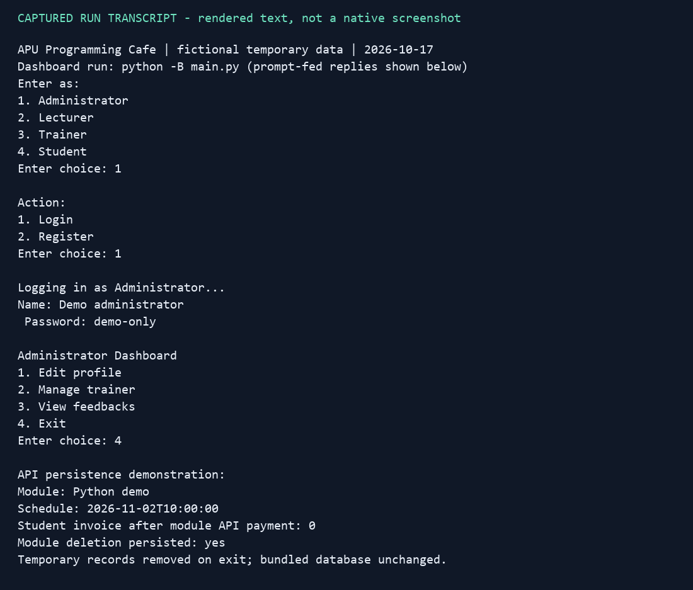
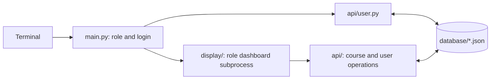

# APU Programming Cafe Management System

A Python console application for coordinating programming courses: students request enrolment, lecturers approve requests, trainers maintain modules, and administrators manage trainers and feedback. This is an Asia Pacific University group coursework project; the repository contains both the main application and older student prototypes. Individual contribution is not inferred from the uploaded code.

**Status:** the damaged source has been repaired. All four role dashboards start, and six regression tests pass. Several menu paths remain incomplete or inconsistent, so this is a learning project rather than a complete course administration service.



*Rendering of an actual captured console transcript, using temporary fictional records on 17 October 2026. This is not a native application screenshot. [Plain-text transcript](docs/assets/demo-transcript.txt).*

## What is implemented

- Role selection, account lookup, and separate dashboards for administrators, lecturers, trainers and students.
- JSON-backed modules, schedules, enrolments, invoices and trainer feedback.
- Student enrolment requests and lecturer approval with matching language/level selection.
- Invoice state used to hide unpaid module schedules; payment is a local state change, with no payment provider.
- Regression coverage for all four login/dashboard/exit paths, module persistence and schedule changes, trainer changes and deletion, and legacy student request display/deletion.



## Run locally

Requires Python 3.10 or later and no third-party packages. Run from the repository root; dashboard launch also expects `python` on PATH to select the intended interpreter.

```powershell
python -B main.py
```

The six bundled JSON files are writable demonstration records. Use a disposable copy for exploration. Generic login-menu registration creates incomplete student/trainer/lecturer records; those accounts may fail in later dashboard actions. Read the [role and data guide](docs/PROJECT_GUIDE.md#roles-and-menus) before exercising them.

To reproduce the preview safely, the demo creates temporary application files and fictional data, drives the real administrator dashboard, then exercises module persistence through the real API:

```powershell
python -B scripts/demo.py
python -B -m unittest discover -s tests -v
```

The demonstration verifies module creation, scheduling, module-side invoice updates and deletion. It does not demonstrate a complete enrolment/payment UI journey. Tests also use disposable application copies, preserving bundled records. [Exact verification and environment](docs/VERIFICATION.md).

## Boundaries to know

Passwords are stored in plain text, default credentials are trivial, and dashboard scripts trust a supplied user ID. Do not use real student information or expose this application as a service. Whole-file JSON rewrites have no locking and can overwrite concurrent changes.

Some menu entries are stubs; trainer feedback sender names conflict with the administrator's ID lookup; deletion can leave dangling relationships; student payment updates only one of two invoice copies. These findings and other data/input limitations are documented in the [detailed issue list](docs/PROJECT_GUIDE.md#issues-found).

The [full project guide](docs/PROJECT_GUIDE.md) preserves the code walkthrough, menus, schema, troubleshooting and assignment context. The original report contains personal information and remains local and ignored; old Git history was not rewritten. No standalone license file is present in this snapshot.
